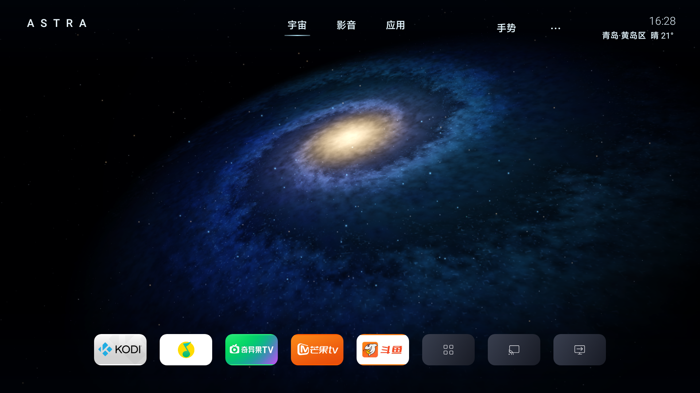
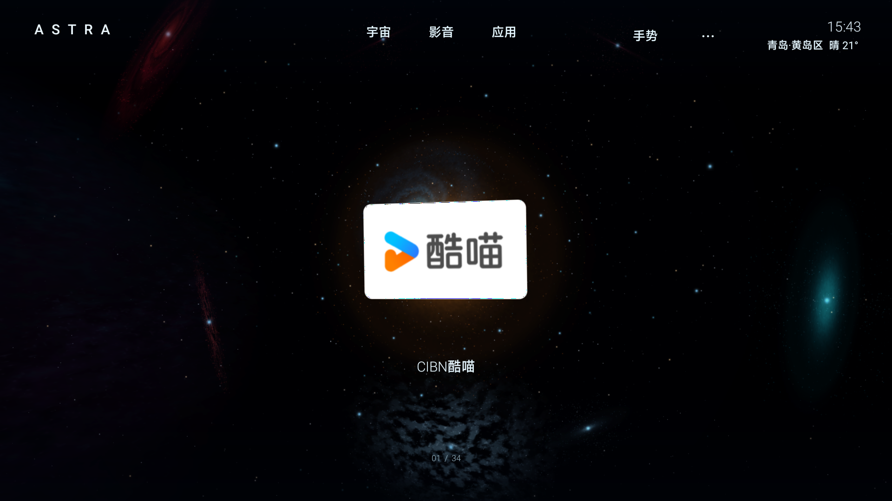
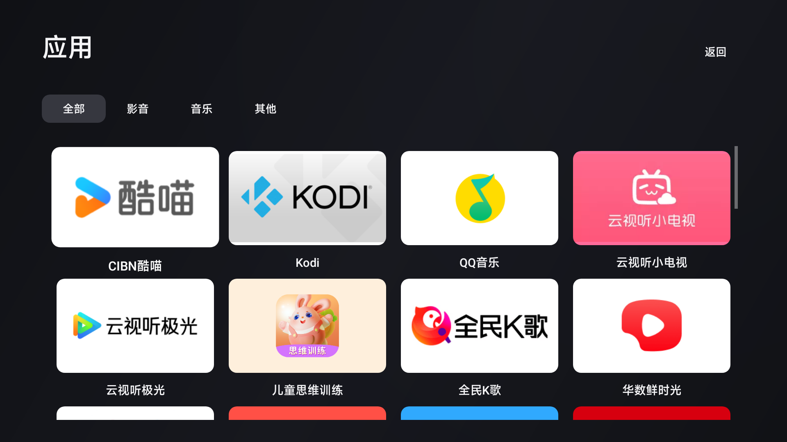
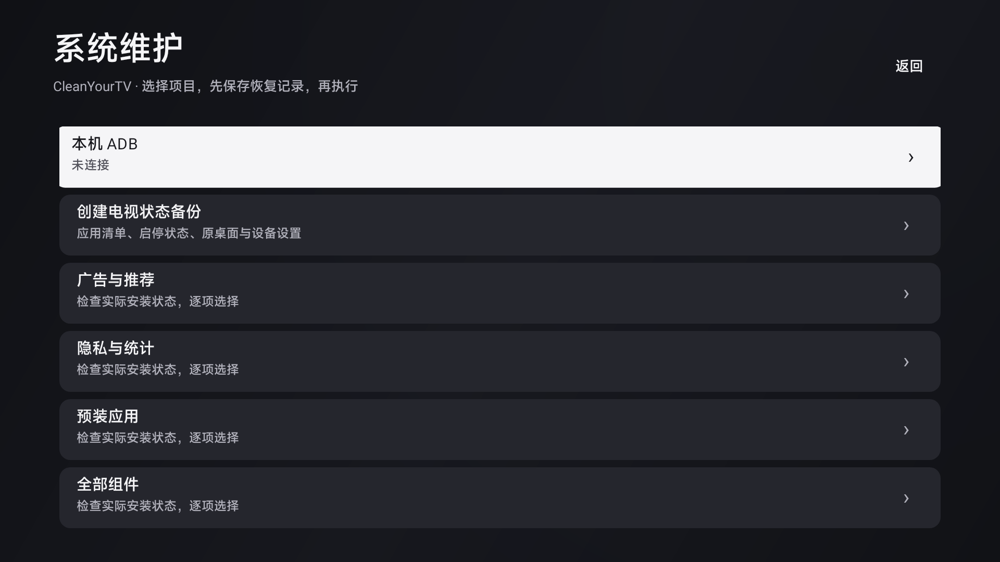
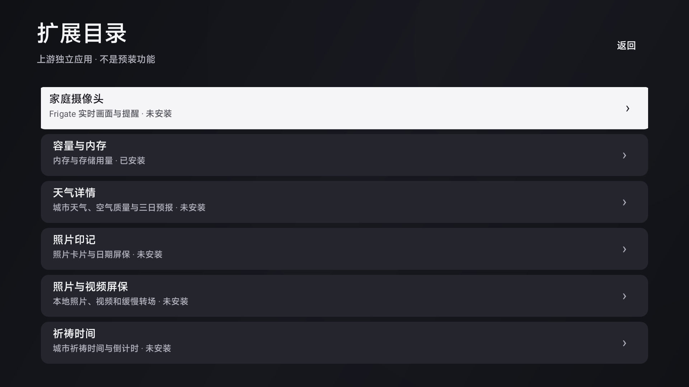

<p align="center"></p>
<h1 align="center">ASTRA 星穹</h1>
<p align="center">把客厅，带进宇宙。<br>A native Android TV launcher with a living galaxy.</p>
<p align="center"><a href="https://theinitialdream1.github.io/astra-tv/">官网</a> · <a href="https://github.com/TheInitialDream1/astra-tv/releases/tag/v0.4.0">下载 APK</a> · <a href="android/README.md">安装与恢复</a> · <a href="README.en.md">English</a></p>
<p align="center"><a href="LICENSE"></a>  </p>



ASTRA 是一个实验性的开源 Android TV 桌面。实时三维星系代替静态壁纸，应用散布在空间里：远看是星光，靠近后显现为清晰的应用图标。保留遥控器的直接操作，也探索摄像头手势。

Android 版使用 **Java 原生控件、OpenGL ES 3 和 MediaPipe 原生推理**，不依赖 WebView 或电脑开发服务器。仓库同时保留早期 Three.js 浏览器原型；官网是独立构建的展示站。

## 当前能力

- **流动的宇宙**：连续星盘、暖色核心、蓝青外臂、暗尘带、差速旋转、局部平流与三维星尘；应用星系从图标提取主色，按包名分配不同形态。
- **空间里的应用**：远近显现、自动镜头跟随、顺序遍历全部可见应用、近景矩形图标、穿梭光效与原创短音效。
- **简洁的电视界面**：原生应用库、信号源、设置、4—7 列应用卡片、4—7 个快捷应用、隐藏与排序、可配置天气和时钟屏保。
- **遥控与实验性手势**：确认进入 / 打开；方向键按顺序切换；返回拉远；菜单或长按确认管理。摄像头开启后可移动掌心指针、捏合打开、双手展开与缩放。
- **可恢复的系统维护**：组件扫描、清理方案预览、停用与原状态记录、恢复中心、APK 导出、默认桌面与私有 DNS 管理、隐私检查和固件更新后核对。
- **按需扩展**：兼容 CleanYourTV 模块卡片 spec 1，按签名批准；提供 19 个上游独立插件的目录与安装入口。插件不是全部内置，需要各自配置。

## 界面记录

| 星云近景 | 应用库 |
| --- | --- |
|  |  |

| 系统维护 | 扩展目录 |
| --- | --- |
|  |  |

首页、近景与应用库为电视应用画面；部分设置及维护页面为 Android SDK 对实际控件的渲染记录。近景和应用库记录于 v0.3.3，其余为 v0.4.0。天气为截图时的示例配置。原始截图来源见 [截图说明](website/public/media/README.md)。

## 项目状态

当前版本 **v0.4.0，实验性预览**。已经完成 19 项核心维护运行时检查；真实上游模块的签名、批准 / 隐藏和配置验证已覆盖。**实际停用与恢复闭环仍待实机联调**，不把代码实现等同于每台电视上的验证结果。

- 已测试过 Android 9 / Mali-G52 的原生渲染和摄像头兼容通路，无法代表所有电视。
- 当前测试机向应用提供 1920 × 1080 窗口，环境缓冲独立缩放。**当前版本不宣称原生 4K 或所有场景稳定 60 FPS。**
- 手势受摄像头接口、光线、距离与性能影响，仍需优化。尚未实现语音对话或系统级语音助手。
- 默认安装只新增 ASTRA，不修改原默认桌面、不停用系统组件。社区清理候选并未逐项验证当前固件。
- 19 个插件的构建和签名校验通过，未逐个完成本机运行验证。

详见 [验证范围](guides/STATUS.md) 和 [CleanYourTV 功能映射](third_party/cleanyourtv/INTEGRATION.md)。

## 开始使用

从 [Releases](https://github.com/TheInitialDream1/astra-tv/releases) 下载 Android APK。需要 Android 8.0 / API 26+ 与 OpenGL ES 3.0；手势需要兼容摄像头。**先保留原桌面和设备专属恢复资料**，再按 [Android 指南](android/README.md) 安装。

### 浏览器原型

需要 Node.js 22.12+：

```sh
npm ci
npm run prepare:assets
npm run dev
```

打开终端打印的本机地址。模型与 WASM 准备到本地，运行时不从 CDN 加载。原型的应用、投屏和信号源入口为浏览器演示，不能直接控制 Android。

### Android 源码构建

需要 JDK 17+、Android SDK Platform 35、Build Tools 35.0.0：

```sh
npm ci
npm run prepare:assets
# 非默认 SDK 位置时先设置 ANDROID_SDK_ROOT
npm run build:android
```

输出 `output/android/AstraTV-0.4.0-native-debug.apk`。完整模型从 Google 官方下载；快速模型来源与打包脚本见 [MediaPipe Lite](third_party/mediapipe-lite/README.md)。

### 官网开发

```sh
npm ci
npm run dev:site
npm run build:site
```

官网源码在 `website/`，构建输出为 `docs/`。推送 `main` 后由 GitHub Actions 构建并部署到 GitHub Pages。官网演示由本项目的原生星系着色器适配到 Three.js，支持暂停、近景切换、减少动态效果和截图画廊。

## 仓库结构

```text
android/       原生桌面、GLES 着色器、摄像头与维护实现
src/           Three.js 浏览器原型
website/       官网源码与可公开的界面图片
scripts/       构建、设备备份、恢复与插件构建工具
tests/         浏览器逻辑及维护工具测试
third_party/   上游来源、许可、模块规范及模型出处
guides/        验证范围与发布说明
```

`output/`、设备备份、ADB 密钥、签名密钥、SDK 路径和编译缓存不提交。每台电视的恢复资料必须在使用者自己的电脑保管，不属于通用安装包。

## 感谢 CleanYourTV

特别感谢 **[CleanYourTV](https://github.com/Gathin23/cleanyourtv)** 及其作者、贡献者。可恢复的维护工作流、社区组件清单、设置兼容和模块卡片规范，为这个项目提供了重要基础。复用范围、固定上游版本和完整 MIT 许可保留在 [third_party/cleanyourtv](third_party/cleanyourtv/)。ASTRA 保留自己的原生星云桌面，不复制上游桌面布局。

也感谢 Three.js、MediaPipe、AdbLib、WebGPU Galaxy 与 Holographic Material。代码复用和纯视觉参考分别列在 [THIRD_PARTY_NOTICES.md](THIRD_PARTY_NOTICES.md)。没有明确复制许可的参考项目未复制其源码。

## 贡献与许可

欢迎提交渲染、交互、摄像头兼容与电视适配的改进。请先阅读 [CONTRIBUTING.md](CONTRIBUTING.md)，安全问题见 [SECURITY.md](SECURITY.md)。

ASTRA 自有代码采用 [MIT License](LICENSE)。第三方代码、模型、依赖和商标保留各自许可与权利；截图中的应用标志不代表关联或背书。
